<a href="https://zerro.dev">
  <picture>
    <source media="(prefers-color-scheme: dark)" srcset="dark_mode.svg">
    
  </picture>
</a>

  <a href="https://zerro.dev"><picture><source media="(prefers-color-scheme: dark)" srcset="assets/btn_portfolio_dark.svg"></picture></a>
  <a href="https://www.linkedin.com/in/nikhil-kumar-swain-408110152/"><picture><source media="(prefers-color-scheme: dark)" srcset="assets/btn_linkedin_dark.svg"></picture></a>
  <a href="https://x.com/iamn1khil"><picture><source media="(prefers-color-scheme: dark)" srcset="assets/btn_x_dark.svg"></picture></a>
  <a href="mailto:nikhilswain36@gmail.com"><picture><source media="(prefers-color-scheme: dark)" srcset="assets/btn_email_dark.svg"></picture></a>

 

  

